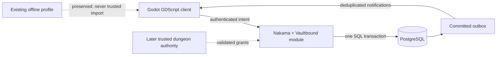

# Backend proposal — Living Sanctuary 6G

Status: proposed, not implemented or deployed. The owner confirmed that there is no existing backend and requested this proposal. The offline game and its separate TEST exchange remain usable; this document does not enable accounts, network trading, real chat delivery or payments.

## Recommendation

Use **Nakama with PostgreSQL**, an official **GDScript Godot client**, and a small custom **Go server module** for Vaultbound's market, wallet, inventory and chat authorization. Keep the Godot game in GDScript. The Go code would run on the server only; no C#, native Android plugin or desktop dependency would be added to the game. This backend language and dependency choice is part of the proposed scope, not an installed component.

Nakama supplies account/session and socket infrastructure. Vaultbound must still implement and test the economy, escrow, ownership, moderation and spatial rules. Its built-in chat, wallet and multiplayer features do not automatically satisfy the game's acceptance criteria. In particular, forwarding client-hosted Godot RPCs is not authoritative combat or trusted reward generation.

Start with a **local, closed test realm** using two authenticated test accounts and a persistent database. Its first social space is an explicitly nonspatial, server-assigned test lobby; it makes no claim that another participant is physically nearby in Sanctuary. Keep all services bound to loopback. Finish the concurrency, recovery and two-client gates below before selecting public hosting. No hosting account, paid service, billing credentials or public endpoint is needed to review this proposal.

| Component | Proposed responsibility |
| --- | --- |
| Existing Godot client | Preserve gameplay; switch explicitly between Offline, TEST Exchange and a future Online Test realm; send intent through an adapter; show server-confirmed outcomes |
| Official Nakama GDScript SDK | HTTPS requests and authenticated WebSocket sessions; pin and verify its version against Godot 4.6.3 and Android before integration |
| Nakama | Account sessions, authenticated RPC/socket entry points, connection lifecycle and administrative infrastructure |
| Vaultbound Go module | Typed command validation, private reads, trade consent, market matching, party/world authorization, rate limits and server-side chat routing |
| PostgreSQL | Authoritative Vaultbound wallet, item custody, orders, trades, claims, ledger, receipts and outbox; migrations, constraints and atomic transactions |
| Background workers | Idempotent expiry, outbox delivery and bounded history aggregation; recover committed work after restart |
| Later Godot headless session authority | Trusted dungeon simulation, encounter rewards and world movement when online expeditions are separately implemented and verified |

## Preserve progression without trusting editable saves

Keep the existing versioned offline profile, backups, Depthmarks, inventory, companions, pets and collection records unchanged. The TEST exchange's synthetic participants and assets can never enter the online database. Separate realm labels, storage paths and IDs make this visible and enforceable.

For the first server build, give the two test accounts fixed, server-created test inventory through an administrative fixture command. Record each grant under a unique receipt. Disable client reward grants and offline profile upload. Test grants must be restricted to the test realm, with no production endpoint accepting them.

Recommended eventual policy: preserve offline play and introduce a separate online progression record. If the owner later wants an offline-to-online migration, design an explicit, auditable import policy with eligibility limits and account-bound treatment; local JSON alone cannot establish legitimate earned wealth. Do not silently reset either realm or merge balances. Online earned dungeon rewards remain blocked until a trusted session authority can validate their source. Finishing the exchange server alone does not make the current offline dungeon multiplayer.

## Database and transaction design

Create a separately migrated `vaultbound` schema rather than changing Nakama's internal tables. The Nakama account ID is the server-derived owner reference; handle account deletion/restriction through the module and reconciliation jobs. Use a single authoritative DM ledger for this game. Do not split one trade between a custom SQL wallet and a separate Nakama wallet/storage API call: those would not be one transaction.

Core tables:

- `accounts`, `wallets`, `catalog_policy`: account restrictions, nonnegative available/reserved DM and versioned eligibility.
- `assets`, `asset_custody`: unique equipment identity or fungible lot, exact variant, owner and one permitted custody location.
- `orders`, `order_reserves`, `trades`, `trade_offers`, `trade_approvals`, `claims`: every reservation has an owner and a recoverable return path.
- `commands`, `transactions`, `ledger_entries`, `sales`, `outbox`: durable request digest/outcome, balanced movement, actual execution history and post-commit notifications.
- `party_memberships`, `world_memberships`, `moderation_reports`, `blocks`: server-controlled routing and access records, separate from public appearance data.

All economic writes use one explicit SQL transaction. Apply integer limits and uniqueness/check constraints in SQL and the module. Lock affected accounts and assets in a consistent order. Serialize matching for the same exact item variant with a transaction-scoped order-book lock, then apply price/time priority at the resting order's price. Bound matching work; any continuation must retain valid escrow and deterministic priority. Handle serialization/deadlock retries using the same idempotency key, never a new purchase intent.

Order entry reserves the full sell quantity or maximum buy cost. Partial fills, price improvement, delivery claims, wallet entries, actual sale rows, command receipt and outbox records commit together. Cancel/expiry competes under the same locks and can return only the remaining reserve. Capacity rules must preserve a safe return path even when ordinary inventory is full.

Trade edits replace escrow and invalidate both locks/approvals. Each authenticated participant separately confirms the same current digest. The second confirmation settles in one transaction after validating both inventories. A disconnect clears uncommitted consent; durable offers pause or expire under a documented policy. A lost response is resolved by command/transaction lookup. Never undo a committed transfer merely because the client missed its notification.

Retain a non-executable tombstone for processed idempotency keys after detailed response retention ends. Pruning UI history must never reopen a financial command. Outbox delivery can repeat; clients deduplicate event IDs and refresh authoritative snapshots. Backups and restore drills must cover the ledger, custody, escrow and receipts together.

The [server contract](living-sanctuary-server-contract.md) specifies intent, errors, routes and adversarial cases. With this stack, those logical routes would initially map to versioned authenticated Nakama RPC names such as `vaultbound.market.create_order.v1`; a second HTTP gateway is unnecessary for the first test. Never use an unauthenticated runtime key as player identity.

## Accounts, social presence and chat

Provision two non-public test accounts first; use short-lived sessions, refresh/revocation and server-derived user IDs. Do not ship administrative credentials, demo passwords or server signing keys in the APK. A production identity/linking/recovery policy and Android secure token storage must be reviewed before release. Until a secure persistent token path is verified, a test client can require login again after restart rather than store a password or refresh token in the profile.

Use the existing LOCAL/WORLD/PARTY panel through a new online adapter. Do not upload offline drafts or preview history. Every send goes through a Vaultbound server handler that enforces identity, channel authorization, text/byte limits, rate limits, block/mute policy and filtering. Prevent a client from bypassing that handler through unrestricted built-in channel APIs.

- **WORLD:** deliver only to authenticated members of the selected server/world.
- **PARTY:** resolve recipients from the current server roster, including membership changes between send and delivery. AI companions are not network recipients.
- **LOCAL:** use server-owned presence and validated position in the same world and radius. Client-reported coordinates alone are insufficient. Keep LOCAL delivery disabled until the relevant authoritative movement/presence path passes its tests.
- **Emotes/inspection:** initially publish only validated public appearance/title/pet data and bounded emote intents to authorized test-lobby participants. Label this nonspatial test scope. Nearby delivery, tap-to-inspect world actors and any proximity-restricted trade requests share LOCAL's position-authority gate; they remain disabled until validated world positions exist. Never expose account credentials, private inventory, wallet or personal information.

For the local test, chat bodies are bounded in-memory history only; restart clears them. Persist submitted moderation reports separately with access controls, not general logs. Proposed public defaults for review: 24-hour ordinary chat history, 30-day report evidence, and a separately approved financial audit retention schedule with permanent replay-prevention tombstones. These are proposals, not implemented retention behavior or legal advice. Verify purge jobs, export/deletion rules and restricted moderator access before public use.

## Independently testable implementation phases

| Phase | Concrete output | Required gate before continuing |
| --- | --- | --- |
| G1 — compatibility and authority | Pin SDK/server/database/module versions and licenses; loopback-only container configuration; explicit online-test adapter and realm separation; two accounts | Godot import/Android export compatibility; authenticated requests; forbidden anonymous/other-account reads; no changes to offline profile or TEST assets |
| G2 — durable economy | SQL migrations, fixed server test grants, item custody, DM ledger, idempotency and recovery endpoints | Actual database constraints; transaction rollback/crash tests; exact equipment identity and DM/item conservation; duplicate grant/command rejection |
| G3 — orders and direct trades | Escrow, partial fills, claims, matching, expiry, two-stage consent, receipts and outbox | Two real authenticated clients; competing fills/cancels; full inventory; offer changes; decline; disconnect before/after commit; offline owner fill; database/server restart |
| G4 — authorized social layer | Server roster/world membership, explicitly nonspatial test-lobby inspection/emotes and trade requests, guarded chat routing, reports and rate limits | Sender spoofing rejected; no cross-party/world delivery; stale membership/revocation handled; LOCAL and all proximity-scoped features remain unavailable until position authority is tested |
| G5 — private integrated review | Existing exchange/chat UI on the real test adapter; failure feedback, reconnect, recovery and bounded history | Two Godot clients, Android keyboard/device pass, latency/loss tests, backup restore and reconciliation; explicit report of remaining dungeon/network limits |
| G6 — optional hosted test | Chosen host/region/budget, TLS, secrets, private database, monitoring/backups and invite controls | Owner approval for the specific public endpoint/services/cost; deployment review; actual hosted two-client tests |

Each phase should produce a reviewed commit and repeat affected preserved-game tests. Do not expose the server while a critical conservation, authentication, recovery or party privacy regression remains unresolved. This proposal does not add ranked PvP, billing, paid entitlements or full authoritative dungeon combat to G1–G5.

## Deployment and cost boundary

For local development, use pinned containers with named disposable test volumes and published ports bound explicitly to `127.0.0.1`. Keep the database, administration console and metrics private. Development defaults in upstream examples must not become public configuration. Benchmark the chosen versions before choosing a machine size; this proposal contains no measured concurrency or hosting-price claim.

For a later small invited test, recommend one application instance plus a separate managed PostgreSQL database, TLS ingress, secret storage, restricted administration and automated backups. This is simpler to operate than an initial cluster, but is not high availability. Compare self-managed application hosting with Heroic Cloud only after the region, expected concurrency and monthly spending limit are known. Obtain current quotes for compute, database, storage/backups, egress, monitoring and any account/email provider before approval. Do not register an account, deploy a service or accept charges as part of this proposal.

The requested review decision is whether to adopt **Nakama + PostgreSQL with a server-only Go module for a local G1–G5 prototype**. Public hosting is a later, separate decision with a concrete quote and tested build. Billing remains the separately gated 6I work; no production or test purchase is processed here.

## Official sources checked

Read on 2026-11-01 through the connected GitHub reader; these establish upstream capabilities, not verified Vaultbound compatibility. No dependency was downloaded or added to the game for this proposal.

- [Nakama server README](https://github.com/heroiclabs/nakama/blob/master/README.md): accounts, chat, sockets, custom runtimes and Apache-2.0 licensing. Read blob `67e333af7aac48a2a589a9880cb549d1fc72e9c2`.
- [Official Godot client README](https://github.com/heroiclabs/nakama-godot/blob/master/README.md): GDScript client for Godot 4.0+, authenticated calls and sockets. Read blob `1fe2ca1f922b46a5751399c35c417866e98ab6cf`; [license](https://github.com/heroiclabs/nakama-godot/blob/master/LICENSE) is Apache-2.0. Its optional C# examples are not part of this proposal.
- [Official Go module template](https://github.com/heroiclabs/nakama-project-template/blob/master/main.go): runtime initialization receives `*sql.DB` and supports RPC/match registration. Read blob `82b3bf6a76016cdda46e36f58a66825f2440853b`. Vaultbound's SQL transaction correctness still requires implementation and tests.
- [Nakama database implementation](https://github.com/heroiclabs/nakama/blob/f79439808027159a06cf802450b8513fd2309736/server/db.go) and [change log](https://github.com/heroiclabs/nakama/blob/f79439808027159a06cf802450b8513fd2309736/CHANGELOG.md): PostgreSQL connection/compatibility references. Pin a supported database/server combination during G1; do not treat upstream default-branch examples as tested deployment configuration.
