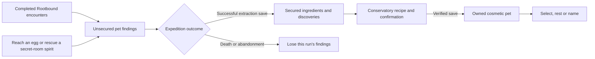

# Spiritweaving and cosmetic companions

Milestone 6E passed its complete automated gate: 13,359 assertions in 80 suites / 97 invocations, plus fresh import and startup. See the [validation report](living-sanctuary-6e-validation.md) and [per-invocation results](living-sanctuary-6e-test-results.json). Physical Android acceptance remains pending.

Spiritweaving uses the existing Rootbound expedition and Sanctuary Conservatory. It does not add a second equipment inventory, change Depthmarks, grant combat bonuses or replace either AI adventurer. Rowan and Lyra retain their party slots and behavior. One selected cosmetic pet follows the player.

## Earn, extract and weave

Registered ordinary and elite encounters provide Rootbound essence. The actual Rootwarden also provides a vessel and a Rootling Guardian memory. Seeded mysterious eggs and secret-room rescues provide a matching creature memory plus an egg or spirit vessel. Revealing a hidden room alone grants no rescue. These are real nearby interaction sources; no unavailable biome or unfinished boss is required.

Findings stay in the current expedition ledger until extraction. They share the same verified save transaction as the existing rewards. A failed save keeps them available for retry; death, retreat or closing the app during the run loses only its unsecured findings. Previously secured ingredients, owned pets, equipment and currency remain.

At the western **G — Spiritweaving Conservatory**, inspect a recipe, its actual costs and any achievement requirement. Creation consumes the displayed cosmetic ingredients once. Selection, resting and naming also save before the new state is shown. A confirmation expires when the source, scene or profile revision changes; reopening a menu does not bypass ownership or costs.

## Initial collection

| Species | Original native visual family |
| --- | --- |
| Lantern Fox | Pointed ears, muzzle and broad luminous tail |
| Crystal Moth | Swept faceted wings |
| Mossdrake | Small quadruped, long tail and moss crest |
| Embercap Sprite | Warm-colored mushroom cap and twig limbs |
| Rift Otter | Rounded body and paddle tail |
| Rootling Guardian | Small trunk, branch arms and sprout crown |
| Moonveil Butterfly | Four broad wing lobes |
| Starbound Wisp | Floating droplet and star facets |

These are procedural placeholders for future art, not imported rigged animals. Embercap is a warm fungus appearance; it does not imply a playable Ember biome. Definitions and recipes live under `resources/pets/`; source weights and achievement requirements use the acquisition policy resource.

Each species can be created once. Natural and luminous variants use the same geometry and have identical gameplay behavior. The first successfully secured matching creature memory supplies immutable mutation provenance. Repeated quotes, cancellation, failed saves, later memories and unrelated equipment transactions cannot reroll that pet's result. The initial luminous chance is 5%, configured in the acquisition policy. There are no paid eggs, purchases, random paid boxes or tradable pet entitlements.

An empty custom name uses the species name. Custom names are display-only, with a limit of 24 Unicode characters / 96 UTF-8 bytes and no unsupported controls or extra lines. They are not network identities.

## Presentation boundary

The follower has no collider, health, attack, revive, loot action or combat target. It follows previously walked player positions using bounded ground and obstruction queries. It cannot scout, discover rooms, draw a route through closed walls or obstruct another actor. If a route becomes unusable, cosmetic recovery hides the pet before a valid reposition; it does not move the player or companions.

Idle, sit/perch, playful and player-emote reactions are finite visual behavior. Reduced motion retains ordinary following while suppressing decorative movement. Luminous tint is restrained by reduced-effects settings. The model used in the Conservatory preview matches the saved selection and variant; the preview has its own isolated world and renders on demand.

The active presenter uses 7–14 mesh instances and 312–828 triangles, with 1–6 animated pivots. Its trail retains at most 128 positions, decisions run ten times per second and each decision permits at most six floor/obstruction queries. No light or particle is added. Structural and simulated-rate checks establish these limits; they do not measure Android frame rate.

## Persistence

Profile version five adds a separate bounded `pets` section for ingredients, discoveries, fixed mutation seeds, ownership, aliases, origin, achievements and active selection. The ordinary 351 item IDs, forty inventory slots, equipment assignments, original `gold` compatibility field, recruited companions and display references remain intact.

Loading versions one through four migrates only in memory. The first successful migrated write preserves exact original bytes in `.pre-v5.bak`, retaining earlier backups and separate snapshots for distinct restored legacy saves. Missing required fields in a claimed v5 file are not silently filled with empty ownership. Valid unavailable pet content is protected as read-only rather than replaced from an older backup. Do not delete an existing profile to resolve a loading warning.

Local saves remain editable offline development data. No pet ownership, currency or item record from this file is an authenticated online entitlement. A future server must validate earned sources and transactions independently.

Physical Android keyboard composition, model appearance, following comfort, sustained performance and thermal behavior remain manual acceptance work. Automated test results and final measured budgets belong in the 6E validation report; this guide does not substitute for them.
